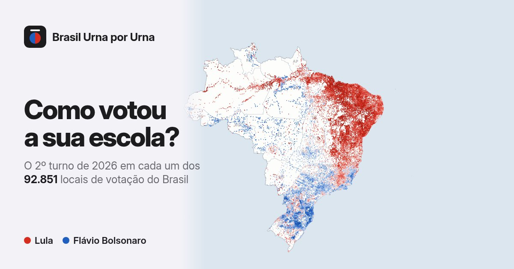
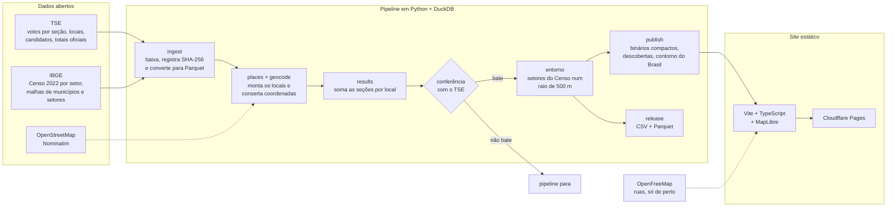

# Brasil Urna por Urna

O resultado da eleição presidencial de 2026 em cada um dos 92.851 locais de votação do Brasil: a escola, o clube, a faculdade onde as pessoas votaram. Os dois turnos, o comparecimento, os brancos e nulos e o perfil de quem mora em volta de cada local, segundo o Censo 2022.

**Mapa:** https://brasil-urna-por-urna.pages.dev/ · **Dados abertos:** [release `dados-2026`](https://github.com/odavicoelho/brasil-urna-por-urna/releases)



Eu queria ver a eleição do jeito que ela aconteceu de verdade, local por local, e não do jeito que ela costuma aparecer, pintada por município ou por estado. O TSE publica tudo o que é preciso para isso, só que espalhado em arquivos enormes, com coordenadas erradas e sem nenhuma informação sobre quem mora em volta de cada escola. Então eu montei o pipeline que junta tudo, confere cada número contra a totalização oficial e publica um mapa que abre rápido no celular.

## Por que isso tem valor

O resultado oficial sai por município, e um município esconde muita coisa. Uma cidade que deu 55% a 45% normalmente é uma colcha de bairros que deram 80% para um lado e 70% para o outro. Em Santarém (PA), por exemplo, tem local que deu 11% para Lula e local que deu 98%, na mesma cidade.

Esse nível de detalhe existe nos dados públicos, mas na prática quase ninguém consegue usar: são centenas de milhares de seções, arquivos de centenas de megabytes, locais renumerados entre um turno e outro e milhares de coordenadas vazias ou erradas. Quem tem equipe e tempo faz essa análise; o resto não.

Com isso aqui:

- **Qualquer pessoa** encontra a escola onde vota e vê como ela votou, comparada com a cidade e com o Brasil.
- **Jornalistas e pesquisadores** têm uma base limpa e conferida, local por local, sem precisar montar o pipeline.
- **Campanhas, partidos e consultorias** veem onde estão os redutos, onde a disputa é apertada e onde o comparecimento é baixo, que é exatamente o que importa para planejar 2028.
- **Quem estuda o país** cruza voto com renda, alfabetização, idade e cor ou raça do entorno, sempre lembrando que são dados de lugares, não de pessoas.

## O que dá para ver

- **O mapa**, com seis camadas: 2º turno, 1º turno, quem mais cresceu entre os turnos, renda do entorno, comparecimento e brancos e nulos. Toque num local e ele mostra o resultado completo, a comparação com o município e o Brasil e o perfil do entorno. Cada local tem um link próprio para compartilhar.
- **Busca** por escola, bairro ou cidade, e um botão para ir direto aos locais perto de você.
- **Descobertas**: seis achados calculados direto dos dados (a virada entre os turnos, renda e voto dentro das capitais, as cidades mais divididas...), cada um com gráfico e botão para compartilhar.
- **Renda e voto**: o eleitorado dividido em cinco faixas pela renda do entorno, com somas exatas de votos, e um gráfico com todos os locais.
- **Como foi feito**: a conferência com o TSE, o que ficou de fora e a data de publicação de cada arquivo usado.

## Como funciona



O pipeline tem uma regra que eu não abro mão: **se um número não bate com a totalização oficial do TSE, nada é publicado.** Depois de somar as cerca de 499 mil seções, ele compara o total de cada candidato em cada estado com o número oficial, nos dois turnos, e confere as contas de cada seção (aptos = comparecimento + abstenções, comparecimento = soma dos votos). A diferença tem que ser zero. Num projeto sobre eleição, se eu errar um número, ninguém confia no resto.

Algumas escolhas e o porquê delas:

- **DuckDB e Parquet** em vez de um banco de dados rodando: os arquivos do TSE têm centenas de megabytes, e o DuckDB lê tudo direto do disco, com SQL, num notebook comum. Não tem servidor para manter.
- **Coordenadas conferidas uma a uma.** O cadastro do TSE tem milhares de locais com coordenada vazia, no meio do mar ou em outro município. Eu confiro cada ponto contra a malha de municípios do IBGE e só aceito uma coordenada nova se ela cair dentro do município certo. O que não deu para localizar com segurança fica fora do mapa (mas continua em todos os totais).
- **O entorno pelo Censo.** Para cada local eu desenho um círculo de 500 m e somo os setores censitários que tocam o círculo, cada um com peso igual à parte da área dele que cai dentro. No campo, onde 500 m pegariam quase ninguém, uso o setor onde o local fica.
- **Feito para o celular.** O mapa pinta com um arquivo binário de ~450 KB (posição e 2º turno de cada local, compactado), o resto das camadas chega logo depois, e o detalhe de cada local só é baixado quando alguém toca nele. De longe, o mapa de fundo é só o contorno do Brasil e dos estados, em ~50 KB; as ruas só aparecem quando a pessoa aproxima.
- **Tudo estático.** Não tem servidor nem banco de dados no ar: o site é um conjunto de arquivos no Cloudflare Pages, que serve arquivos estáticos sem limite de tráfego no plano gratuito. Se o mapa viralizar, ele aguenta, e o custo continua zero.

## Conferência

Os números só são aceitos se baterem com o TSE. O comando `urna results` confere:

- **votos de cada candidato em cada UF**, nos dois turnos, contra a totalização oficial: diferença zero;
- **comparecimento, abstenções, válidos, brancos e nulos por UF**, contra a totalização oficial, nos dois turnos: diferença zero;
- **cada uma das ~499 mil seções**: os dois arquivos do TSE concordam entre si e as contas fecham;
- **toda seção tem um local de votação cadastrado.**

O resultado fica em `data/silver/conferencia.json` e aparece na página "Como foi feito" do site. Dois detalhes dos dados do TSE que o pipeline trata: votos em candidatura anulada contam como **nulo técnico**, igual à totalização oficial; e alguns arquivos de votação trazem o número antigo de locais que foram renumerados, então cada seção é ligada ao seu local pelo cadastro de locais (município + zona + seção).

## O entorno de cada local

- **Indicadores:** população estimada, renda média do responsável pelo domicílio, alfabetização (15 anos ou mais), faixas de idade e cor ou raça.
- **Sigilo do IBGE:** quando uma contagem é muito pequena, o IBGE publica "X" no lugar do número. Essas contagens entram como zero (o efeito é mínimo) e uma renda média sigilosa não entra na média.
- **Conferências do `urna entorno`:** os setores da malha e das tabelas são os mesmos (472.780), a população somada dos setores é exatamente a do Censo 2022 (203.080.756 pessoas) e nenhum percentual sai de 0 a 100.

É uma aproximação: o eleitor costuma votar perto de casa, mas nem sempre. Tudo aqui descreve lugares, nunca o voto de uma pessoa.

## O que fica fora do mapa

Cerca de 1.300 locais com urna (menos de 1% dos votos) não aparecem no mapa porque a coordenada publicada pelo TSE está vazia ou errada e não foi possível localizá-los com segurança. Os votos deles continuam contando em todos os totais. Locais só com seções agregadas não tiveram urna própria (os eleitores votaram na seção principal) e também não aparecem.

## Dados abertos

O [release `dados-2026`](https://github.com/odavicoelho/brasil-urna-por-urna/releases) traz as tabelas finais em CSV (abre no Excel e no Google Planilhas) e em Parquet:

| arquivo | o que tem |
|---|---|
| `locais_votacao_2026` | os 94.343 locais com urna: endereço, coordenada, seções e de onde veio a coordenada |
| `votos_por_local_2026` | votos de cada candidato em cada local, nos dois turnos |
| `comparecimento_por_local_2026` | aptos, comparecimento, abstenções, válidos, brancos e nulos por local e turno |
| `entorno_censo2022_por_local` | o perfil do entorno de cada local no mapa |
| `candidatos_2026` | número, nome de urna e partido |
| `conferencia.json`, `fontes.json` | o resultado das conferências e cada arquivo de origem com data e SHA-256 |

O dicionário completo está no `LEIAME.md` dentro do pacote. Para gerar de novo: `urna release`.

## Como rodar

```bash
cd pipeline
python3 -m venv .venv && .venv/bin/pip install -e ".[dev]"
.venv/bin/urna ingest    # baixa as fontes (≈ 650 MB) e converte para Parquet
.venv/bin/urna places    # monta os locais de votação e confere as coordenadas
.venv/bin/urna geocode   # localiza os que ficaram sem coordenada confiável (1 req/s, com cache)
                         # --offline usa só o cache, sem requisições novas
.venv/bin/urna results   # soma os votos por local e confere com a totalização oficial
.venv/bin/urna entorno   # perfil do entorno de cada local (Censo 2022, raio de 500 m)
.venv/bin/urna publish   # dados do site em web/public/dados/ (inclui as descobertas)
.venv/bin/urna release   # pacote de dados abertos em data/release/
```

Cada arquivo baixado fica registrado em `data/manifest.json` (URL, tamanho, SHA-256 e data de publicação), para qualquer pessoa conferir que usou os mesmos dados.

O site fica em `web/`:

```bash
cd web
npm ci
npm run dev                      # http://localhost:5173/
npx wrangler login --scopes account:read user:read pages:write   # só na primeira vez
../scripts/publicar-site.sh      # build + publicação no Cloudflare Pages
```

O formato dos arquivos do site está descrito em `pipeline/src/urnaporurna/publish.py`. Os dados do site (~80 MB) não vão para o repositório: saem do pipeline direto na publicação.

## Licença

Código: MIT. Dados de origem: TSE e IBGE (dados abertos). Coordenadas geocodificadas: © colaboradores do OpenStreetMap, licença ODbL. Mapa de fundo: OpenFreeMap / OpenMapTiles, dados © OpenStreetMap.
